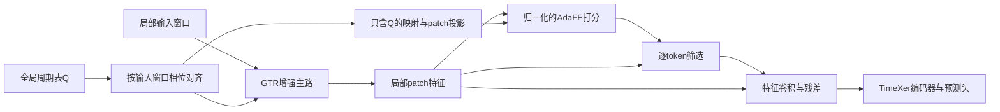

# TimeXerGTR + AdaFE：PEMS04 / PEMS07 诊断与周期指导原型
日期：2026-10-13。代码与日志来自本项目；运行仅在 10.21.25.109 的 tslib 环境、远程 CUDA 上进行。

## RevIN关闭后的补充结果
同日已完成RevIN=0的周期指导开关配对：PEMS04 MSE降低13.68%、MAE降低10.37%；PEMS07 MSE降低0.37%、MAE增加0.11%。配置与实测证据见[补充报告](X:/TEST/GTR-main/docs/gtr-guided-adafe-revin0-pilot-20261013.md)。

## 第一轮结论与边界
本次完成了固定最佳权重探测、两数据集五组配对短程训练、两个周期错位干预和8项远程GPU契约。最强的短程信号是关闭RevIN（PEMS04/07验证MSE分别改善6.49%/10.93%）。独立Q条件指导AdaFE也有额外MSE收益（3.46%/1.53%），但PEMS07的MAE增加1.43%，因此仍应作为研究原型。

目前最强的证据是：PEMS07 有一次真实的联合训练失稳；现有 AdaFE 没有显式接收 GTR 周期条件。本轮STE最佳权重探测中，scorer梯度存在且代理饱和率很低，不能据此保证结构组合的预测性能。Hard模式的二值比较本身仍不向scorer传播梯度。

完成结果的配置为 use_revin=1。诊断期间用户已把 PEMS04/07 脚本改为 use_revin=0，且 PEMS07 重跑已经开始；这两个版本必须分开比较。论文 GTR 的 PEMS04/07 官方配置关闭 RevIN，PEMS08 开启，但它的骨干是 MLP，不能把该配置直接当作 TimeXer 的最优设置。

## 已完成结果的实际差距
以下都是训练集 StandardScaler 后的标准化指标。PEMS04 为种子2026/2027/2028平均；PEMS07只有2026完成，不能视为三种子均值。

| 数据集 | 预测长度 | TimeXer MSE | 修复组合 MSE | 修复组合 MAE |
|---|---:|---:|---:|---:|
| PEMS04 | 12 | 0.071969 | 0.070864 | 0.172141 |
| PEMS04 | 24 | 0.085285 | 0.083278 | 0.186947 |
| PEMS04 | 48 | 0.107067 | 0.102537 | 0.209172 |
| PEMS04 | 96 | 0.146691 | 0.136199 | 0.246395 |
| PEMS07 | 12 | 无匹配结果 | 0.057638 | 0.155731 |
| PEMS07 | 24 | 无匹配结果 | 0.070024 | 0.162452 |
| PEMS07 | 48 | 无匹配结果 | 0.090107 | 0.185283 |
| PEMS07 | 96 | 无匹配结果 | 0.122315 | 0.215400 |

PEMS04相对TimeXer改善1.54%、2.35%、4.23%、7.15%。旧Git结果中，纯GTR的PEMS04 MSE为0.065847/0.075855/0.093830/0.117013，比当前组合低；不过它是不同骨干、seed2024和配置，不能把差距直接归到AdaFE。此前没有匹配的TimeXerGTR-only正式实验。

## 训练稳定性证据
PEMS07、预测12步、seed2026的原曲线：第7轮train=0.0560781、val=0.0554905；第8轮train=0.2699281、val=0.3866169。OneCycle此时接近最高学习率0.001。之后恢复一部分，但到第12轮早停，最终使用第7轮权重。原曲线已保存到 evidence_snapshot/training_histories/ 对应JSON。

PEMS07、96步第9轮也有验证尖峰（0.1759404→0.2826151），但训练误差仍下降，不能把两种波动混为同一种崩溃。

当前scorer学习率倍率0.1只作用于FourierPolyMask；GTR、Q、卷积、LayerNorm、残差门和TimeXer仍用主学习率。生产训练没有梯度裁剪。建议先单独测试较低最高学习率或固定较低学习率，记录所有分支的梯度范数，再测试裁剪；不宜仅继续降低scorer学习率。

## 固定最佳权重的远程探测
每种情况使用128个均匀分布的验证窗口，保持权重不变。8个固定anchor窗口分别独立预测及与15个其他窗口同批预测。以下是局部干预，不是正式完整数据集结果。

| 数据集 / 长度 | 同批样本改变后最大输出差 | 平均掩码改变比例 | 同窗口按batch1 / batch16计算的MSE |
|---|---:|---:|---:|
| PEMS04 / 12 | 0.122737 | 4.434% | 0.069281 / 0.069207 |
| PEMS04 / 96 | 0.151509 | 2.477% | 0.114912 / 0.114804 |
| PEMS07 / 12 | 0.052405 | 2.228% | 0.054747 / 0.054758 |
| PEMS07 / 96 | 0.464164 | 0.914% | 0.129565 / 0.129492 |

输出差为标准化尺度。共享阈值确实使预测依赖同批窗口，修正具有明确理由；但这次平均MSE差只有约0.02%–0.11%，尚不足以解释主要性能差距。

最佳权重上scorer梯度均存在、有限；代理sigmoid饱和比例约0.014%–0.092%。因此没有证据支持“修复后scorer仍完全学不到”。
PEMS07、96步的AdaFE残差gamma从初始0.05增长到0.908311，scorer输出std约11.49；这提示长预测对增强分支依赖很强，后续可独立测试残差门约束，但这些是在最佳权重上的数值，不能还原崩溃瞬间的梯度。

固定权重关闭AdaFE或GTR会恶化这批验证误差；例如PEMS07/96两者开启MSE0.129492，关闭AdaFE0.289007，关闭GTR0.308786。这说明当前权重已经依赖两分支，不能通过直接关掉模块判断“重新训练后的基线谁更好”。

诊断JSON：reports/gtr_guided_adafe_20261013/pems04/ 与 pems07/。探测涉及用户重跑前读取的旧权重；今后重跑应重新记录权重哈希和独立路径。

## 当前结构为什么没有实现显式周期指导
1. TimeXerGTR先计算 x + gamma_g * GTR(x,Q)，再形成patch token，然后把混合token送入AdaFE。没有独立周期条件输入。
2. GTR(x,Q)包含局部卷积和周期查询卷积两部分，不能直接把整个输出当作纯全局先验。
3. AdaFE对隐藏坐标做cos/sin与多项式展开，卷积沿隐藏维滑动，没有时间轴FFT，也不处理相邻patch的连续结构。
4. 原阈值为所有batch、传感器、patch、hidden的共同scores.mean()；STE尺度也在整个过程batch上汇总。
5. scorer直接接收embedding与位置编码；现有LayerNorm位于增强输出端，不能稳定scorer输入。

## 已实现的最小原型
新增 models/TimeXerGTRGuidedAdaFE.py 与 layers/gtr_guided_adafe.py。生产主实验尚未注册这一研究原型。

仅由Q产生的周期位置潜在条件来自：
q[b,t,c] = Q[(cycle_index[b] - seq_len + t) % cycle_len, c]
g = value_embedding(patch(GTR.linear(q)))

Q未被约束为真实周期信号，g不具有周期分解的幅值语义。g不包含局部输入，不添加位置编码或dropout。保留当前GTR增强主路，再用周期条件直接调整AdaFE打分：
s = FourierPolyMask(LayerNorm(z)) + tanh(alpha) * Linear(LayerNorm(g))

alpha的有效初值为0.05。阈值与STE尺度按每个token的hidden维计算，消除跨样本和跨节点阈值依赖；卷积、输出残差和global token保持原语义。guided_adafe_use_prior=False可单独关闭周期条件，隔离它的贡献。

这称为“周期条件特征筛选”更准确；要研究真正的频带增强，另需沿时间/patch轴的FFT或频段路径，而非把当前FourierPolyMask当作频谱模块。

远程GPU契约：8项全部通过，包括共享初始化/RNG、M/MS形状、global token保留、gamma=0与基线等价、纯Q条件对齐、批内样本独立、周期扰动改变score，以及关闭GTR主路后Q仍通过guide获得梯度。训练与预测收益需另外验证。

## 配对筛选协议
scripts/gtr_guided_adafe/run_pilot.py生成五组独立实验：
- TimeXerGTR、RevIN1。
- 修复AdaFE、RevIN1。
- 修复AdaFE、RevIN0。
- 新scorer归一化＋逐token阈值、周期条件关闭、RevIN1。
- 同一新原型、周期条件开启、RevIN1。

共同骨干/GTR和共有AdaFE参数的初始化哈希一致；训练索引、shuffle生成器和forward随机种子一致。固定主学习率3e-4、scorer倍率0.1、梯度裁剪1.0对五组均适用。默认1024训练窗口、256验证窗口、6轮、预测24步、d_model512。没有构造或评估测试集，也没有使用它选择结构。

该筛选可以判断初期训练方向，不能替代全训练集、多个预测长度、三种子和正式测试。与原0.001 OneCycle的训练记录不应混在一张正式性能表中。

## 后续决策
先看RevIN关闭后的正式重跑及配对筛选。若无周期条件的稳定scorer已有改善，再判断条件开启的额外收益；只有后者稳定改善才能支持“GTR指导AdaFE有效”。后续独立消融可以包括连续soft mask、受限残差门、沿时间/patch的卷积。不要把这些同时加入首轮实验，否则无法归因。

注意现有experiment_setting和日志名没有编码RevIN，两个配置会复用同一checkpoint目录。当前重跑已经复用这些路径。新配对runner使用独立目录并拒绝覆盖；用户日常正式重跑也应给不同model_id/目录。

## 来源与阅读范围
- [GTR：Enhancing Multivariate Time Series Forecasting with Global Temporal Retrieval，2602.10847v1](https://arxiv.org/html/2602.10847v1)：全文方法与表6；[PEMS04官方配置](https://github.com/macovaseas/GTR/blob/main/scripts/GTR/pems04.sh)、[PEMS07官方配置](https://github.com/macovaseas/GTR/blob/main/scripts/GTR/pems07.sh)。
- [FeTS固定源码](https://github.com/lllucky111/FeTS/blob/457d4477c9258e4d7be6b498dd723dce821baa74/models/FeTS.py)：实际读取源码；本项目只移植AdaFE子模块，未移植原DSFFN。
- [CycleNet，2409.18479v2](https://arxiv.org/html/2409.18479v2)：全文方法和交通场景附录C.5，提醒周期之外的跨节点依赖和时滞仍重要。
- [FAN，2409.20371v1](https://arxiv.org/html/2409.20371v1)：实际FFT主导成分与残差建模方法全文。
- [FreqCycle，2603.09661v1](https://arxiv.org/abs/2603.09661)：仅摘要；全文下载超时，未据此做细节判断。

## 近常量窗口假说的核验
另在两数据集的训练/验证中各均匀采样256个96步输入窗口，计算每节点的训练集StandardScaler空间标准差。验证节点窗口std<0.01比例为PEMS04的0.150%、PEMS07的0.134%；std中位数分别0.595、0.542。原始流量精确零值比例分别1.590%、0.452%，零值并未被认定为缺失。

因此，不能把“多数交通窗口近常量导致RevIN失效”作为本次主要解释。关闭RevIN的收益如果成立，更需要检查局部幅值与共享Q条件的相互作用及优化路径。数据描述结果见 reports/gtr_guided_adafe_20261013/data_norm/summary.json。

## PEMS04配对筛选与周期错位干预
预测24步，6轮，1024训练窗口、256验证窗口，统一固定主学习率3e-4、scorer倍率0.1和clip1，所有共有参数初始化/数据顺序均对齐。以下不是正式测试集成绩。

| 配对分支 | 最佳验证MSE |
|---|---:|
| TimeXerGTR / RevIN1 | 0.113962 |
| 修复AdaFE / RevIN1 | 0.114081 |
| 修复AdaFE / RevIN0 | 0.106681 |
| 新归一化逐token scorer / 周期条件关闭 / RevIN1 | 0.112688 |
| 同一新scorer / 周期条件开启 / RevIN1 | 0.108788 |

关闭RevIN相对原修复版降低约6.49%；开启周期条件相对同一新scorer关闭条件降低约3.46%。最优值都在第6轮，说明尚未收敛，不能把这些数值当作最终性能或种子均值。

进一步固定有guide的最佳权重，保持GTR主路的cycle_index正确，只干预独立guide的索引：
- 正确对齐：MSE 0.108788。
- guide错位144步（12小时）：MSE 0.210028，增加93.06%。
- guide总使用固定相位0：MSE 0.178324，增加63.92%。
- 当前权重禁用guide：MSE 0.178242，增加63.84%。

正确对齐复现了原筛选结果。这个受控干预支持新分支实际利用了周期位置条件，而不仅是增加可学习参数；同时，它显示错误周期条件可能严重损害预测。禁用guide的冻结权重结果不能与重新训练的无guide基线混淆。独立JSON见 guidance_probe_pems04/results.json；完整配对结果见 pilot_pems04/summary.json。

## 周期条件信息流

## PEMS07配对筛选与最终判断
两数据集均为预测24步、单seed2026、6轮、1024训练窗口、256验证窗口。配对初始化、共有AdaFE权重、guide初始权重、索引、shuffle、forward RNG和源码哈希已独立核验一致；五组均全部完成，best_epoch均为6，没有证明收敛。

| 分支 | PEMS04验证MSE / MAE | PEMS07验证MSE / MAE |
|---|---:|---:|
| TimeXerGTR / RevIN1 | 0.113962 / 0.235342 | 0.109092 / 0.228504 |
| 修复AdaFE / RevIN1 | 0.114081 / 0.238756 | 0.105017 / 0.223587 |
| 修复AdaFE / RevIN0 | 0.106681 / 0.234415 | 0.093539 / 0.214907 |
| 新scorer / guide关闭 / RevIN1 | 0.112688 / 0.234975 | 0.104405 / 0.221379 |
| 新scorer / guide开启 / RevIN1 | 0.108788 / 0.230696 | 0.102806 / 0.224548 |

单因子对比：
- 原AdaFE关闭RevIN：PEMS04 MSE降低6.49%、MAE降低1.82%；PEMS07 MSE降低10.93%、MAE降低3.88%。
- 同一新scorer开启周期条件：PEMS04 MSE降低3.46%、MAE降低1.82%；PEMS07 MSE降低1.53%、MAE增加1.43%。

PEMS07冻结指导权重的相位干预也复现原验证结果：正确guide MSE0.102806；只把guide错位12小时后0.228155（增加121.93%）；固定相位0时0.179760；禁用guide时0.175177。GTR主路周期索引始终不变。说明guide有实质参与，同时错误条件会损害结果；这不是重新训练的基线比较。

建议按这个顺序继续：
1. 先确认用户已经启动的RevIN0完整重跑。维持训练集StandardScaler；关闭RevIN并不等于取消所有标准化。
2. 单独验证较低学习率与梯度裁剪，减少峰值学习率阶段的失稳，并记录门控和各分支梯度。
3. 在选定的归一化/训练设置下重新配对比较guide开关，扩展到预测12/24/48/96及三种子，最后固定配置后做正式测试。
4. 若PEMS07仍有MSE/MAE取舍，再独立测试连续soft mask或受限/可靠性相关的残差门；不把几个结构修改一次堆在一起。

第一轮未测试guide与RevIN0的组合；后续配对现已完成，见文首补充报告。原型不是当前生产默认模型。诊断所需的代码、契约与筛选已经完成；正式性能提升仍待全量验证。

